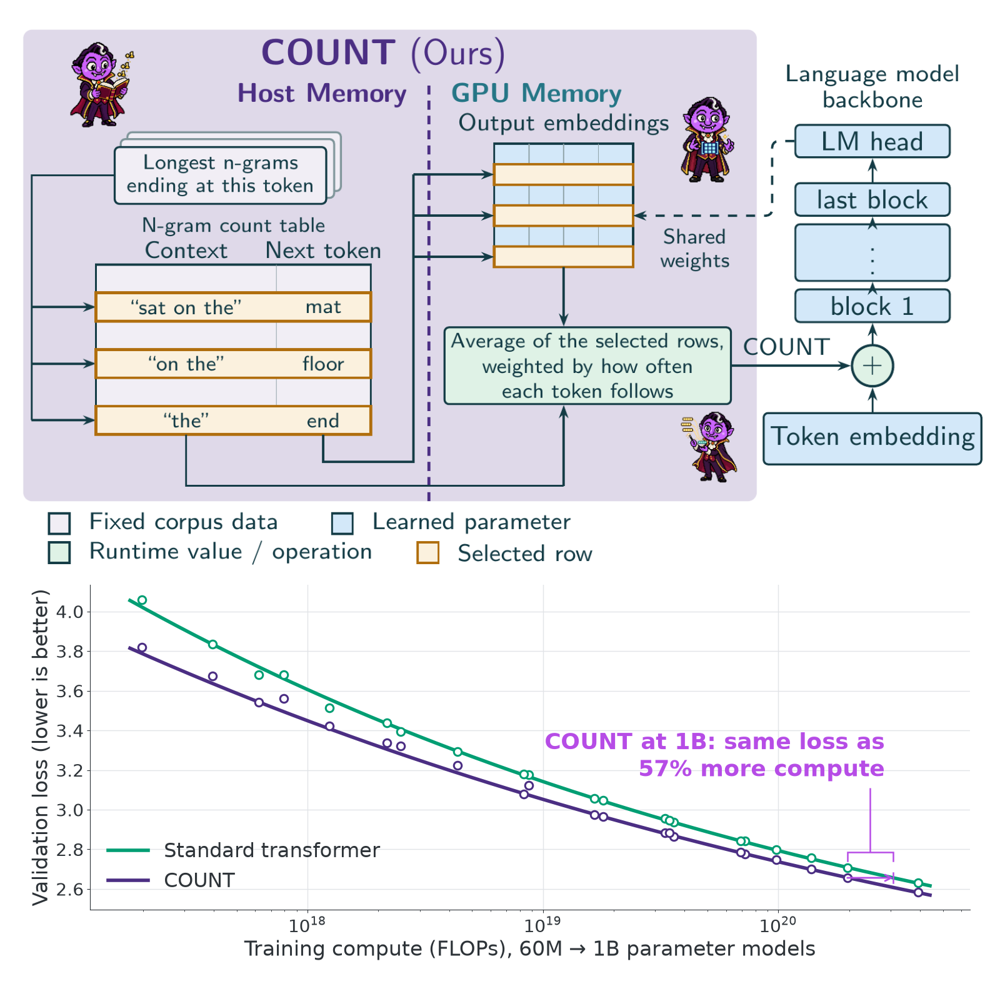

<p align="center">
  
</p>

<h1 align="center">The COUNT: Counting N-grams Unlocks Scaling on Host Memory and Training-Free Adaptation</h1>

<p align="center">
  Ian Magnusson<sup>1</sup> &nbsp; Noah A. Smith<sup>1,2</sup> &nbsp; Pang Wei Koh<sup>1</sup><br>
  <sup>1</sup>University of Washington &nbsp; <sup>2</sup>Allen Institute for AI
</p>

<p align="center">
  <a href="https://arxiv.org/abs/2610.20456"></a>
  <a href="https://huggingface.co/datasets/IanMagnusson/count-ngram-tables"></a>
  <a href="https://huggingface.co/IanMagnusson/count-checkpoints-count"></a>
  <a href="LICENSE"></a>
</p>

COUNT (Counting Offline Unlocks N-gram Transformers) adds n-gram memory to a
language model without adding learned parameters. For each position it looks
up the most frequent next tokens of the longest matching n-grams in a
precomputed table of corpus counts, which lives in read-only CPU RAM, and adds
a count-weighted average of those tokens' output embeddings to the input.
Across 60M to 1B parameter models, a 1B model with a 797 GB table reaches the
validation loss of a standard transformer trained with 57% more compute, and
swapping in a domain-specific table at inference adapts the model with no
training.

<p align="center">
  
</p>

This repository holds the code for the paper: the table-building pipeline, the
two embedding methods inside a fork of OLMo-core, one launch script for the
shared model ladder, and the evaluation aggregates.

**Scope.** This is the core method implementation in its simplest form: it
reproduces the paper's results, but it is not the optimized runtime behind the
paper's throughput measurements. In particular the n-gram table lookup here
runs on the trainer's main process before each forward pass rather than in
the data-loader workers, and the learned n-gram embeddings use a dense
optimizer rather than sparse row-wise updates.

| Directory | Contents |
|---|---|
| `olmo-core/` | Fork of [OLMo-core](https://github.com/allenai/OLMo-core) with COUNT embedding and learned n-gram embeddings. The diff against the upstream commit it is based on is the method implementation. |
| `src/thecount/counts/` | N-gram counting over a tokenized corpus (plain, with the parallel chunked version under `optimized/`). |
| `src/thecount/tables/` | Stupid-backoff scoring and the packer that writes the top-K table read at training time; each is a plain implementation with the corpus-scale version under `optimized/`. |
| `src/thecount/eval/` | The CE / BPB / Acc aggregates reported in the paper, and the command that prints them for saved metrics files. |
| `tests/` | Unit tests for the table pipeline and aggregates. |

## Environment

Python 3.12. Install the OLMo-core fork and the table tools:

```bash
python -m venv .venv && source .venv/bin/activate
pip install -e "./olmo-core[eval,beaker]"   # PyTorch, the fork, the evaluation suite
pip install -r requirements.txt             # numpy, pytest, wandb
export PYTHONPATH=$PWD/src:$PWD
```

The `beaker` extra and `wandb` are needed even for local runs: OLMo-core
imports both at startup. `wandb` must be below 0.29, whose `finish()` no longer
accepts the `quiet` argument OLMo-core passes at shutdown; the pin is in
`requirements.txt`. Runs log offline (`WANDB_MODE=offline`) unless configured
otherwise.

Run the tests:

```bash
pytest tests                                   # table pipeline and aggregates
(cd olmo-core && PYTHONPATH=src pytest -m 'not gpu' \
  src/test/data/count_table_test.py \
  src/test/nn/transformer/count_embedding_test.py \
  src/test/train/train_module/transformer/count_train_module_test.py \
  src/test/scripts/count_ladder_test.py)
```

## The two methods in OLMo-core

Both methods live in `olmo-core/src/olmo_core/nn/transformer/model.py` and are
attached by `olmo_core/train/train_module/transformer/train_module.py`.

* `CountNgramEmbedding` implements COUNT embedding. For each position the
  table lookup returns, for each of the longest matching n-gram orders, the
  top-K continuation token IDs and their stupid-backoff log scores. The
  embedding is the score-weighted sum of the output-head rows of those tokens,
  averaged over the requested number of orders (missing orders contribute
  zero), added to the token embedding, then normalized and scaled by the
  square root of the hidden width (embedding amplification).
* `LearnedNgramEmbedding` implements learned n-gram embeddings: for each order
  from two upward, several hashed tables of learned rows, concatenated and
  projected, averaged with the token embedding, then amplified.
* `olmo_core/data/count_table.py` reads the packed table and performs the
  lookup, including interpolation of two tables' scores at lookup time, which
  is what table swapping with a mixing weight uses.

Configuration fields on `TransformerTrainModuleConfig`: `count_ngram`,
`count_table_dir`, `count_k`, `count_max_order`, `count_num_orders`,
`count_mix_table_dir`, `count_mix_lambda`; `learned_ngram`,
`learned_ngram_max_order`, `learned_ngram_tables_per_order`,
`learned_ngram_table_sizes`, `learned_ngram_eos_token_id`.

## Building a table

A table is built in three steps: n-gram counts, stupid-backoff scoring, and
a packed top-K table.

**Counts.** `thecount.counts.count_corpus --corpus-dir <dir of uint32 shards>
--out-dir <counts> --max-order 6 --min-count 1 --partitions 256` counts every
n-gram up to the maximum order over a tokenized corpus (headerless
little-endian `uint32` shards, documents separated by the EOS token). A window
may end with the separator but never contains it in its history. `--min-count`
is the n-gram count floor. The output is range-partitioned parts
`order<n>.range<NNNNN>.bin` of fixed-width records: `n` little-endian `uint32`
token IDs followed by a little-endian `uint64` count, sorted
byte-lexicographically on the key bytes. The default implementation forms an
order's windows in memory; `--implementation optimized` selects
`thecount.counts.optimized`, which counts partitions in parallel worker
processes for corpus-scale inputs. The two write identical parts, which
`tests/test_count_corpus.py` checks.

**Stupid-backoff scoring.** `thecount.tables.stupid_backoff_scoring --parts parts.json --out-dir
<scores> --min-order 1 --max-order 6 --tau <history-count floor> --alpha 0.4
--kmax <candidates per history>` scores every history with at least `tau`
occurrences by stupid backoff (a continuation is scored by its count ratio at
the longest observed history, multiplied by 0.4 for each fallback to a shorter
history) and writes one row per history holding its `kmax` highest-scoring
continuations. `parts.json` maps each order to the list of its count-part
paths. The default is a plain in-memory implementation written to be read;
`--implementation optimized` selects `thecount.tables.optimized`, which
streams the parts through a worker pool and vectorizes the merge, for
corpus-scale tables. The two write byte-identical files, which
`tests/test_stupid_backoff_scoring.py` checks.

**Pack.** `thecount.tables.pack --input-dir <scores> --output-dir <table>
--max-order 6 --K 32 --min-history-total <history-count threshold>
--vocab-size 100278` writes the table file and a build manifest. It keeps the
histories with at least `--min-history-total` occurrences, crops each row to
its `K` highest-scoring continuations, and re-sorts each order into numeric
token order for the reader's binary search. Scores are stored in 8 bits,
linearly quantized per order between the smallest retained finite score and
zero. `--orders` selects which orders receive rows without changing the scores
of the remaining rows. `--dry-run` validates the scored rows and reports sizes
without writing. The default implementation holds one order in memory;
`--implementation optimized` selects `thecount.tables.optimized`, which
memory-maps and chunks every array and also offers `--dry-run`. The two write
byte-identical tables and manifests, which `tests/test_pack.py` checks.

## Training

`olmo-core/src/scripts/train/ladder/count_ladder.py` runs the shared ladder for
the vanilla backbone, COUNT, or learned n-gram embeddings. Set `OLMO_ROOT_DIR`
to the save root and `OLMO_EVAL_MIX_BASE_DIR` to the directory holding the
OLMo-core in-loop validation mix. `--data-root` names a directory with one
sub-directory of tokenized `.npy` shards per source (`--data-source` selects
sources). The table should be on a RAM filesystem such as `/dev/shm`.

```bash
export OLMO_ROOT_DIR=/path/to/runs OLMO_EVAL_MIX_BASE_DIR=/path/to/eval-mix
export WANDB_MODE=offline WANDB_API_KEY=offline
LADDER=olmo-core/src/scripts/train/ladder/count_ladder.py
COMMON="--cluster local/h200 --size 190M --sequence-length 8192 --chinchilla-multiple 2.0 \
        --max-gpus 8 --minimum-world-size 8 --fixed-global-batch-size 524288 --rank-mbz 8 \
        --seed 1042 --attn-backend flash_3 --data-root /path/to/tokenized"

# vanilla backbone
torchrun --standalone --nproc-per-node=8 $LADDER run --name vanilla-190m $COMMON
# COUNT embedding: per-order fusion over orders 1..6 with K = 8 of the table's 32 candidates
torchrun --standalone --nproc-per-node=8 $LADDER run --name count-190m $COMMON \
  --count-table-dir /dev/shm/table --count-k 8 --count-max-order 6 --count-num-orders 6
# learned n-gram embeddings: orders 2-3, four tables per order, the paper's 1:1 setting at 190M
torchrun --standalone --nproc-per-node=8 $LADDER run --name learned-190m $COMMON \
  --learned-ngram-rows-per-table 148267 --learned-ngram-max-order 3 --learned-ngram-tables-per-order 4
```

`--attn-backend flash_3` selects FlashAttention 3, which the paper's runs used
on H100 and H200 GPUs. The install above does not include it: build it from the
`hopper/` directory of [flash-attention](https://github.com/Dao-AILab/flash-attention)
against the installed PyTorch, or drop the flag to use PyTorch's attention, which
is slower but trains the same model.

**Resuming a released checkpoint.** The saved trainer state records a
fingerprint of the data paths it was trained on, and resuming refuses data whose
fingerprint differs. When your tokenized data is the same corpus at different
paths, pass `--ignore-data-fingerprints`. The released learned n-gram
checkpoints carry sparse row-wise optimizer state, which this code's dense
optimizer cannot resume from; loading their optimizer state stops with an
error that says so, while evaluating them is unaffected.

The ladder's learning rate, warmup, WSD-S schedule, and evaluation endpoints
are OLMo-core's; `--fixed-global-batch-size` pins the global batch to the
values in the paper. Model geometry per `--size` is in
`olmo_core/model_ladder/transformer_model_configurator.py`.

## Evaluating with a swapped or mixed table

`eval-checkpoint` reruns the in-loop evaluators once on a saved checkpoint.
Passing a different `--count-table-dir` evaluates the trained model with a new
table; `--count-mix-table-dir` and `--count-mix-lambda` interpolate two tables'
scores at lookup time; a smaller `--count-k` or `--count-num-orders` evaluates
with fewer candidates or orders than were used in training.

```bash
torchrun --standalone --nproc-per-node=1 $LADDER eval-checkpoint --name count-190m \
  --cluster local/h200 --size 190M --sequence-length 8192 --chinchilla-multiple 2.0 \
  --max-gpus 1 --minimum-world-size 1 --fixed-global-batch-size 524288 --rank-mbz 8 \
  --data-root /path/to/tokenized --checkpoint-path $OLMO_ROOT_DIR/model-ladders/count-190m/190M/step14523 \
  --eval-output-dir /path/to/eval-out --no-load-trainer-state \
  --count-table-dir /dev/shm/math-table --count-k 8 --count-max-order 6 --count-num-orders 6
```

Metrics are written as `metrics_step*.json`. The paper's aggregates are the
mean token cross-entropy over the 11 language-model validation sources, the
mean bits per byte over 74 downstream task configurations, and the mean
accuracy over 41 task configurations:

```bash
python -m thecount.eval.endpoint_summary /path/to/eval-out/metrics_step14523.json
```

## Released artifacts

| Artifact | Where | Notes |
|---|---|---|
| N-gram tables: 797 GB and 142 GB general tables, the 17 GB table used below 370M, and math, biomedical and law tables | [count-ngram-tables](https://huggingface.co/datasets/IanMagnusson/count-ngram-tables) | The 797 GB table is split into four parts; reassemble with `cat forward_index_topk.bin.part-* > forward_index_topk.bin && sha256sum -c SHA256SUMS` |
| COUNT checkpoints, 60M to 1B at three training budgets | [count-checkpoints-count](https://huggingface.co/IanMagnusson/count-checkpoints-count) | Full checkpoints with optimizer state, in this repo's ladder layout |
| Learned n-gram embedding checkpoints | [count-checkpoints-learned-ngram](https://huggingface.co/IanMagnusson/count-checkpoints-learned-ngram) | Pass the size's target `--learned-ngram-rows-per-table` (m, listed on the model card); the ladder sizes the hashed tables m+1, m+3, …, m+15 as in training. Their optimizer state is sparse row-wise, so they evaluate but do not resume with this code |
| Standard transformer checkpoints | [count-checkpoints-standard-transformer](https://huggingface.co/IanMagnusson/count-checkpoints-standard-transformer) | One seed per size, batch-matched to the treatments |

Each checkpoint directory is laid out as `model-ladders/<method>-<size>/<SIZE>/step<N>/`,
so pointing `OLMO_ROOT_DIR` at a download lets `eval-checkpoint` find it.

## Citation

```bibtex
@article{magnusson2026count,
  title   = {The {COUNT}: Counting N-grams Unlocks Scaling on Host Memory and Training-Free Adaptation},
  author  = {Magnusson, Ian and Smith, Noah A. and Koh, Pang Wei},
  journal = {arXiv preprint arXiv:2610.20456},
  year    = {2026}
}
```

## License

This code is released under the [Apache License 2.0](LICENSE), the same license
as the OLMo-core code it builds on.
